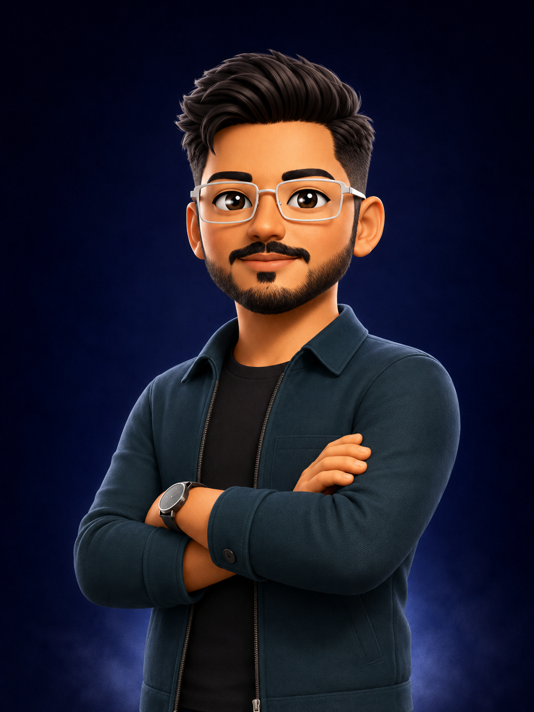

<div align="center">



# NK Systems — Portfolio

### Backend-Focused Full Stack Developer

Secure REST APIs, real-time applications, reusable developer tooling, and scalable MERN platforms.

[GitHub Repository](https://github.com/nitin16112004/nk-systems) •
[LinkedIn](https://www.linkedin.com/in/nitin-kumar-70b7962b1) •
[GitHub](https://github.com/nitin16112004) •
[NPM](https://www.npmjs.com/package/@nitinkumar16/backendkit)

</div>

---

## 🚀 About This Project

A modern, premium developer portfolio built to showcase backend engineering, full-stack development, open-source work, technical skills, and production-focused projects.

The portfolio presents Nitin Kumar’s work as a backend-focused full-stack developer and final-year Computer Science student at GLA University.

**Built to demonstrate:**

- Secure backend API development
- Authentication and role-based authorization
- Real-time application architecture
- Reusable developer tooling
- Full-stack MERN development
- Clean and maintainable code structure
- Responsive and accessible UI design
- Practical software engineering mindset

---

## ✨ Key Features

### 🎨 Premium Design

- Dark theme with cyan, blue, and indigo accents
- Inter font with strong typography hierarchy
- Smooth animations powered by Framer Motion
- Glassmorphism UI with a frosted navigation bar
- Responsive design optimized for desktop, tablet, and mobile
- Animated galaxy-style background
- Accessible reduced-motion support

### 🚢 Interactive Ship Navigation

- Animated ship that follows the active section
- Smooth spring-based movement
- Direction-aware animation behavior
- Active-section tracking while scrolling
- Desktop-focused experience with mobile-friendly fallback

### 📱 Responsive Navigation

- Horizontal navigation on smaller screens
- Touch-friendly spacing
- Active section highlighting
- Smooth section navigation
- Responsive text sizing and layout

### 📝 Portfolio Sections

- **Hero** — Introduction, role, location, social links, and resume
- **About** — Background, focus, and current learning
- **How I Build** — Engineering principles and development approach
- **Metrics** — Open-source and project highlights
- **What I Build** — Backend, real-time, tooling, and full-stack capabilities
- **Timeline** — Education, project experience, and open-source journey
- **Projects** — Featured projects with detailed Deep Dive modals
- **Skills** — Technical stack and core computer science knowledge
- **Open Source & Learning** — BackendKit, SQL practice, and Salesforce learning
- **Contact** — Professional contact information and social links

### 🔧 Technical Features

- Centralized portfolio data configuration
- Reusable typed components
- Project Deep Dive modal with internal scrolling
- Scroll tracking and active-section detection
- SEO metadata for personal branding
- Vercel Analytics integration
- Responsive Next.js image optimization
- Accessible icon labels and keyboard interactions
- Production-ready lint and build workflow

---

## 🛠 Tech Stack

### Core

- **Next.js 16** — React framework with App Router
- **React 19** — UI library
- **TypeScript** — Type-safe development
- **Tailwind CSS 4** — Utility-first styling

### Animation & Interaction

- **Framer Motion** — Smooth page and component animations
- **Lucide React** — Interface icons
- **Custom Hooks** — Scroll tracking and active-section detection

### Analytics

- **Vercel Analytics** — Page analytics and performance insights

### Development & Deployment

- **Git & GitHub** — Version control
- **npm** — Package management
- **Vercel** — Frontend deployment
- **ESLint** — Code quality and linting

---

## 📂 Project Structure

```text
nk-systems/
├── app/
│   ├── globals.css              # Global theme and utility styles
│   ├── layout.tsx               # Root layout, metadata, and analytics
│   └── page.tsx                 # Main portfolio page
├── components/
│   ├── navigation/
│   │   ├── ShipNavigator.tsx    # Animated section navigator
│   │   └── ShipSVG.tsx          # Ship illustration and animation
│   ├── sections/
│   │   ├── About.tsx
│   │   ├── Contact.tsx
│   │   ├── HowIBuild.tsx
│   │   ├── Metrics.tsx
│   │   ├── OpenSource.tsx
│   │   ├── Projects.tsx
│   │   ├── Skills.tsx
│   │   ├── Timeline.tsx
│   │   └── WhatIBuild.tsx
│   ├── Footer.tsx
│   ├── GalaxyBackground.tsx
│   ├── Hero.tsx
│   ├── Navbar.tsx
│   └── SectionWrapper.tsx
├── data/
│   └── portfolio.ts             # Central portfolio content and links
├── hooks/
│   ├── useActiveSection.ts
│   └── useScrollDirection.ts
├── public/
│   ├── nitin-profile.png        # Portfolio avatar
│   └── nitin-kumar-resume.pdf   # Resume
├── package.json
└── README.md
```

> The structure may evolve as new features and project case studies are added.

---

## 💼 Featured Projects

### 1. BackendKit — Secure Express Backend Toolkit

An open-source npm package for reusable Express.js backend architecture.

**Highlights:**

- JWT access and refresh token flows
- Authentication middleware
- Role-based authorization
- Zod validation
- Security middleware
- Standardized API responses
- Structured logging
- Centralized error handling
- 197 automated tests
- 200+ npm downloads

**Package:**  
[@nitinkumar16/backendkit](https://www.npmjs.com/package/@nitinkumar16/backendkit)

---

### 2. Alumni Bridge Platform

A full-stack alumni mentorship and networking platform.

**Core capabilities:**

- Student, alumni, and administrator roles
- JWT authentication
- Role-based access control
- Real-time chat with Socket.IO
- Notifications
- Mentorship workflows
- Jobs, events, and discussion modules

**Stack:** React, Node.js, Express.js, MongoDB, Mongoose, Redux Toolkit, Socket.IO

---

### 3. CareerGuid AI

An AI-assisted career platform focused on resume-first onboarding, ATS improvement, personalized learning roadmaps, and job readiness.

**Planned architecture:**

- React and TypeScript frontend
- Node.js and Express.js backend
- Python and FastAPI AI service
- Supabase PostgreSQL and authentication
- Redis and background workers
- Docker-based development environment
- RAG-powered learning roadmaps

**Status:** Currently building

---

### 4. Library Management System

A Python command-line application using object-oriented programming and Excel-based persistence.

**Features:**

- Student management
- Book management
- Issue and return workflows
- Duplicate validation
- Search functionality
- Excel-based storage
- Unit testing

---

## 🎯 Design Philosophy

### Typography

- **Font:** Inter
- **Headings:** Bold, compact, and high-contrast
- **Body:** Readable spacing with muted supporting text
- **Responsive Scaling:** Fluid font sizes across breakpoints

### Colors

- **Background:** Black and deep navy
- **Primary Accent:** Cyan and blue
- **Secondary Accent:** Indigo
- **Status Accent:** Emerald
- **Text:** White with layered opacity

### Animation Principles

- **Purposeful:** Motion supports navigation and hierarchy
- **Subtle:** Animations enhance rather than distract
- **Accessible:** Reduced-motion preferences are respected
- **Performant:** GPU-friendly transforms are preferred

---

## 🚀 Getting Started

### Prerequisites

- Node.js 20 or later
- npm
- Git

### Installation

```bash
# Clone the repository
git clone https://github.com/nitin16112004/nk-systems.git

# Navigate into the project
cd nk-systems

# Install dependencies
npm install

# Start the development server
npm run dev
```

Open:

```text
http://localhost:3000
```

### Production Build

```bash
npm run lint
npm run build
npm run start
```

---

## 🌐 Deployment

This project is designed for deployment on Vercel.

After connecting the GitHub repository to Vercel:

1. Select the `nk-systems` repository.
2. Keep the detected framework as Next.js.
3. Use the default build command:

```bash
npm run build
```

4. Deploy the project.
5. Add the final live URL to the top section of this README.

---

## 📌 Current Focus

- Backend development
- MERN full-stack development
- Secure REST API design
- Real-time applications
- Open-source package maintenance
- Docker and Redis
- Backend system design
- Salesforce Administration through Trailhead
- 2027 graduate software engineering opportunities

---

## 🔮 Roadmap

### Planned Improvements

- [ ] Add the production deployment URL
- [ ] Add verified live project links
- [ ] Add GitHub activity integration
- [ ] Add project filtering by technology
- [ ] Add dedicated project case-study pages
- [ ] Add a contact form
- [ ] Add resume interaction analytics
- [ ] Improve project screenshots and media
- [ ] Add accessibility testing
- [ ] Add automated CI checks

### Continuous Improvements

- [ ] Update project content
- [ ] Improve mobile spacing
- [ ] Refine animations
- [ ] Improve SEO metadata
- [ ] Monitor performance
- [ ] Keep dependencies updated safely

---

## ✅ Quality Checks

Before merging changes into `main`, run:

```bash
npm run lint
npm run build
```

Recommended manual checks:

- Hero and avatar
- Resume button
- Email actions
- GitHub, LinkedIn, and NPM links
- Navbar and ship navigation
- All project Deep Dive modals
- Modal scrolling on mobile and desktop
- Contact section
- Responsive behavior at 375px, 768px, 1024px, and 1440px

---

## 🧑‍💻 Author

**Nitin Kumar**  
Backend-Focused Full Stack Developer  
B.Tech Computer Science, GLA University

📧 Email: nitinkumar16072005@gmail.com  
📱 Phone: +91 6386646961  
📍 Location: Mathura, Uttar Pradesh, India

**Open to Backend, Software Engineering, Full-Stack, Internship with PPO, and 2027 Graduate Roles**

### Profiles

- [LinkedIn](https://www.linkedin.com/in/nitin-kumar-70b7962b1)
- [GitHub](https://github.com/nitin16112004)
- [NPM](https://www.npmjs.com/package/@nitinkumar16/backendkit)

---

## 📄 License

This repository is intended for portfolio, learning, and reference purposes.

If you reuse major parts of the original design or implementation, retain appropriate credit to the original source repository.

---

## 🙌 Acknowledgments

- **Next.js** for the application framework
- **React** for the UI architecture
- **Vercel** for deployment and analytics
- **Framer Motion** for animations
- **Tailwind CSS** for styling utilities
- **Lucide** for interface icons
- **Open-source community** for tools and learning resources

---

<div align="center">

**Built securely. Designed thoughtfully. Improved continuously.**

© 2026 Nitin Kumar — NK Systems Portfolio

[⬆ Back to Top](#nk-systems--portfolio)

</div>